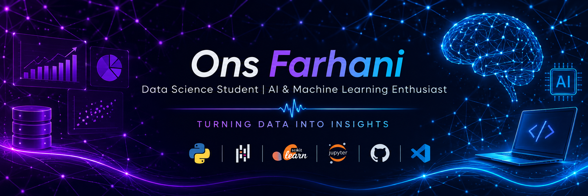

<!-- ================= HEADER ================= -->

<!-- CUSTOM DATA SCIENCE BANNER -->

 

# 👋 Hi, I'm Ons Farhani

### Data Science Student | AI & Machine Learning Enthusiast

  

  
  
  

---

<!-- ================= ABOUT ME ================= -->

## 👩‍💻 About Me

- 🎓 Data Science student
- 🧠 Passionate about Artificial Intelligence and Machine Learning
- 📊 Interested in data analysis, visualization, and predictive modeling
- 💻 Building software projects and exploring new technologies
- 🌱 Continuously learning and improving my skills
- 🚀 My goal is to transform data into meaningful insights

---

<!-- ================= TECH STACK ================= -->

## 🛠️ Tech Stack

### Programming Languages

### Data Science & Machine Learning

### Tools

---

<!-- ================= GITHUB STATS ================= -->

<!-- ================= CONNECT ================= -->

## 🤝 Connect With Me

---

<!-- ================= FOOTER ================= -->

### ✨ Build. Learn. Grow.

